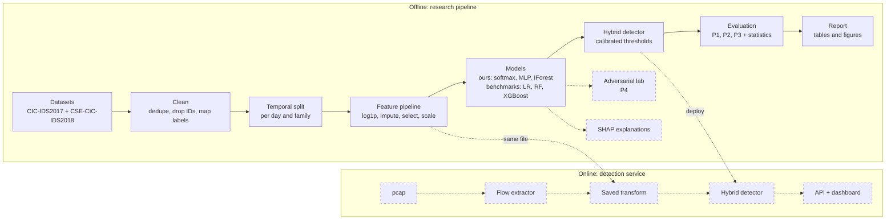

<div align="center">

# FlowGuard

**A network intrusion detector that is tested on a second network, tested against an attacker,<br/>and says so when it sees something it doesn't know.**


[How it works](#how-it-works) · [Quick start](#quick-start) · [Method](#method) · [Evaluation](#evaluation) · [Status](#project-status) · [References](#references)

</div>

---

FlowGuard classifies network flows (CICFlowMeter features) as benign traffic or one of seven attack families. When traffic looks like nothing it was trained on, it flags it as a possible zero-day instead of forcing it into a known class.

Most intrusion detection results are measured on the same dataset the model was trained on, which says little about a real deployment. FlowGuard is built around the questions that do matter:

- **Does it still work on another network?** We train on CIC-IDS2017 and test on CSE-CIC-IDS2018, a different network captured a year later.
- **Can it catch an attack it has never seen?** A hybrid of a classifier and an anomaly detector is tested on attack families held out of training.
- **Can an attacker evade it?** Evasion attacks are limited to what a real attacker controls: their own packets.
- **Are the numbers real?** No leakage, confidence intervals and significance tests on every score, and an ablation that measures what each design choice is worth.

> Final-year Machine Learning project, Cyber Security Engineering.

## Highlights

- **Models written from scratch in NumPy.** Softmax regression, a multi-layer perceptron with hand-written backpropagation, and an Isolation Forest. No pretrained model and no ML library is used for them. scikit-learn and XGBoost are trained on the same data only as benchmarks, to show our implementations are correct.
- **Gradient-checked.** The analytic gradients of our models match numerical gradients to a relative error below 1e-5.
- **Leakage controlled by design.**
  - IPs, ports and timestamps are removed.
  - Duplicate flows are removed *before* splitting.
  - The split follows time.
  - Every transform is fitted on training data only.
  - An ablation measures how much the scores would be inflated without deduplication.
- **Honest metrics.**
  - Macro-F1, false alerts per 10,000 benign flows and PR-AUC. Accuracy is never used to rank models.
  - 95% bootstrap confidence intervals on every score.
  - McNemar's test between every pair of models.
- **Calibrated hybrid detector.** Temperature scaling makes the classifier's confidences trustworthy before they are thresholded. The thresholds are fitted to a false-alert budget on validation data only.
- **Explains the generalization gap, not just measures it.** Per-feature drift between the two networks, a domain classifier, and an experiment that adapts to the new network without any labels.

## Research questions

| | Question | Protocol |
|---|---|---|
| **RQ1** | How well do linear, neural and tree-based models detect and classify attacks on the network they were trained on? | P1 |
| **RQ2** | How much of that performance survives on a different network? | P2 |
| **RQ3** | Can a hybrid detector (classifier + anomaly detector) catch an attack family it never saw in training? | P3 |
| **RQ4** | How easily can an attacker who controls only their own traffic evade the detector, and how much does adversarial training help? | P4 |

## How it works

Two pipelines share one saved feature transform, so the deployed model sees live traffic exactly the way it saw training data. Dashed boxes are not built yet (see [Project status](#project-status)).



The original design document, with every component explained, is in [`docs/architecture.html`](docs/architecture.html) (download it and open it in a browser).

## Quick start

```bash
git clone https://github.com/ihebmabroukii/flowguard.git
cd flowguard
python -m venv .venv
source .venv/bin/activate          # Windows: .venv\Scripts\Activate.ps1
pip install -e ".[all]"
pytest                             # runs on synthetic flows, no dataset needed
```

Then [download the data](#getting-the-data) and run the pipeline:

```bash
make data features tune train eval analyze report
```

Python 3.11 or newer. Our models need only NumPy. `[all]` adds the libraries the pipeline needs (pandas, scikit-learn, XGBoost, matplotlib, MLflow), plus serving and dev tools. PyTorch (`[dl]`) and IBM ART (`[adv]`) are optional extras, used only for comparison.

Windows has no `make` by default. Install it (`winget install GnuWin32.Make` or `scoop install make`), or run the `python -m ...` commands listed under each target in the [Makefile](Makefile).

## Getting the data

Both datasets come from the Canadian Institute for Cybersecurity and were generated with the same flow tool, which is what makes the cross-dataset test possible. We use the **corrected** releases from DistriNet (KU Leuven). The originals contain mislabeled flows and buggy features (Engelen et al., 2021; Liu et al., 2022).

| Dataset | Size | Used for | Put it in |
|---|---|---|---|
| CIC-IDS2017, improved, `CICIDS2017_improved.zip` | 328 MB | Training; protocols P1, P3, P4 | `data/raw/cic-ids2017/` |
| CSE-CIC-IDS2018, improved, `CSECICIDS2018_improved.zip` | 9.7 GB | Testing only; protocol P2 | `data/raw/cse-cic-ids2018/` |

Download page: <https://intrusion-detection.distrinet-research.be/CNS2022/Dataset_Download.html>

```bash
curl -L -C - -o data/raw/cic-ids2017/CICIDS2017_improved.zip https://intrusion-detection.distrinet-research.be/CNS2022/Datasets/CICIDS2017_improved.zip
curl -L -C - -o data/raw/cse-cic-ids2018/CSECICIDS2018_improved.zip https://intrusion-detection.distrinet-research.be/CNS2022/Datasets/CSECICIDS2018_improved.zip
```

`-C -` resumes an interrupted download. The loader reads the CSVs straight out of the zips, so unzipping is optional. Datasets, trained models and experiment logs are git-ignored and rebuilt with `make`.

## Running the pipeline

| Step | Command | Writes |
|---|---|---|
| Load, clean and split | `make data` | `data/processed/*.parquet`, cleaning report, split counts |
| Fit the feature pipeline | `make features` | `models/pipeline.joblib` |
| Hyperparameter search | `make tune` | `reports/tables/tuning_*.csv`, `models/tuning/*.json` (used by `make train`) |
| Train classifiers and the hybrid | `make train` | `models/p1/*.joblib`, validation metrics |
| Protocols P1 to P3 | `make eval` | test metrics with confidence intervals, confusion matrices, McNemar tables |
| Calibration, curves, drift, adaptation | `make analyze` | `reports/tables/` |
| Ablation study (retrains, slow) | `make ablate` | `reports/tables/ablation.csv` |
| Report | `make report` | `reports/tables/*.md` and 10 figures in `reports/figures/` |
| Experiment browser | `mlflow ui` | <http://127.0.0.1:5000> |

Every number in the report is rebuilt from these targets. Notebooks are for looking at things only: any code a reported number depends on lives in `src/flowguard/`.

## Method

### Data

- **Loading.** Both improved releases share one 89-column header. The loader streams each day's CSV out of the zip in 500k-row chunks (some 2018 days are over 3 GB) and writes Parquet. CSE-CIC-IDS2018 is sampled while loading (5% of benign flows, 50% of attack flows), because it is only a test set.
- **Labels.** Raw labels are mapped to eight families: `Benign, DoS, DDoS, PortScan, BruteForce, WebAttack, Botnet, Infiltration`. The mapping uses ordered rules in [`configs/labels.yaml`](configs/labels.yaml). An unknown label stops the pipeline rather than being guessed. Following the dataset authors, "Attempted" flows (attack traffic with no malicious payload) become Benign, and Heartbleed (a handful of flows) is dropped.
- **Cleaning.**
  - We drop every column that identifies the lab rather than the attack: row id, flow ID, IPs, ports and timestamp. That leaves 80 features.
  - Infinite rates become missing values.
  - Exact duplicate flows are removed **before** splitting, along with any feature vector that appears under two different families.
  - Every step's row count is saved for the report.
- **Splitting.** The flows of each (day, family) group are ordered by time. The first 70% train (the last 15% of that portion is validation) and the remaining 30% test. Splitting per family matters because several attacks lasted under an hour: a plain cut by time of day would put them entirely in train or entirely in test.
- **Features.** Signed `log1p` for heavy-tailed counters, median imputation, removal of constant and near-duplicate (|r| > 0.98) features, then quantile scaling. The pipeline is fitted on the training split only and saved. The online service loads the same file.

### Models

| Model | Written by | Role |
|---|---|---|
| Softmax regression | **Us**, NumPy | Multi-class logistic regression: weighted cross-entropy, L2, mini-batch Adam, early stopping |
| MLP | **Us**, NumPy | 3 ReLU hidden layers, dropout, He initialization, hand-written backpropagation. Its input gradient drives the P4 attacks |
| Isolation Forest | **Us**, NumPy | Anomaly detector trained on benign traffic only (Liu et al., 2008) |
| **Hybrid** | **Us** | Our MLP for known attacks + our Isolation Forest gate for unknown ones |
| Majority class, random guess | **Us**, NumPy | Trivial baselines: the floor every model has to clear |
| Logistic regression | scikit-learn | Benchmark for our softmax regression |
| Random Forest, XGBoost | scikit-learn, XGBoost | Strong tree-ensemble benchmarks |

**Model selection.** `make tune` runs a random search (Bergstra and Bengio, 2012) over learning rate, L2 penalty, batch size, layer sizes and dropout. Each of the 20 trials is scored by validation macro-F1. Trial 0 is always the hand-picked configuration, so the search can only match or beat it. Test data plays no part in any choice.

**Verifying our implementations** ([`tests/test_scratch.py`](tests/test_scratch.py)):

- **Gradient checks.** Analytic gradients (weights, biases and inputs) are compared with central-difference numerical gradients.
- **Known behaviour.**
  - Softmax regression cannot learn XOR, and the MLP can.
  - Class weights raise minority-class recall.
  - Early stopping restores the best epoch.
  - A fixed seed gives identical weights.
- **Against the library.** Our softmax regression's predictions are compared with scikit-learn's, and our Isolation Forest's anomaly ranking with scikit-learn's.

### Hybrid detector

```text
c = max over attack families of P(family | flow)      classifier confidence, after temperature scaling
a = Isolation Forest anomaly score                    0..1, higher = stranger

if   c >= τ   ->  alert: known attack (the most likely family)
elif a >= θ   ->  alert: Unknown (possible zero-day)
else          ->  benign
```

1. **Temperature scaling** (Guo et al., 2017). A single parameter T is fitted on validation flows by minimizing the negative log-likelihood. This is a convex 1-D problem, solved with golden-section search. Dividing every logit by T never changes the predicted family. It fixes over-confidence: a network that puts benign flows at exactly 1.0 leaves no threshold that can separate them.
2. **Thresholds from a false-alert budget.** τ and θ are set on benign *validation* flows only. By default the budget is 1 benign alert per 1,000 flows. τ may use at most half of it. θ uses what is left, on the flows τ did not flag.
3. **Every decision is explained.** Each one carries its reason (`known_attack`, `unknown_anomaly` or `benign`), the confidence, the most likely family and the anomaly score.

## Evaluation

| Protocol | Train | Test | Answers |
|---|---|---|---|
| **P1** In-dataset | First 70% of each (day, family) group of CIC-IDS2017 | Last 30% of each group | RQ1 |
| **P2** Cross-dataset | The same P1 models | CSE-CIC-IDS2018, families present in both datasets | RQ2 |
| **P3** Leave-one-family-out | P1 training data minus one attack family; the classifier is retrained and the hybrid recalibrated | P1-test benign + every flow of the held-out family | RQ3 |
| **P4** Adversarial | P1 models, then hardened models | Attack flows perturbed within the threat model | RQ4 |

- **P2 reuses the P1 models**, so the P1 → P2 drop measures only the change of network. 2018 families that 2017 lacks cannot be named by any model. They are left out of macro-F1 and reported separately as a detection rate.
- **P3** reports where the held-out family ends up: flagged Unknown, alerted under a wrong family, or missed as benign. It does this for the classifier alone and for the hybrid.

**Metrics.**
- Macro-F1 and per-family recall.
- False alerts per 10,000 benign flows.
- Detection rate and PR-AUC.
- Confusion matrices.
- Throughput in flows per second.

We never rank models by accuracy. About 80% of flows are benign, so a detector that never alerts scores about 80%. The trivial baselines show this in our own results table.

### Analysis beyond the protocols

| Analysis | Question it answers | Module |
|---|---|---|
| **Confidence intervals** | Is 0.91 vs 0.93 a real difference? Every P1/P2 score gets a 95% bootstrap interval. The metrics depend only on the confusion counts, so resampling flows is exactly a multinomial draw over the confusion cells: 1,000 resamples take milliseconds. | [`eval/stats.py`](src/flowguard/eval/stats.py) |
| **McNemar's test** | Are two models significantly different on the same flows? Exact binomial or continuity-corrected χ², with Holm correction across all pairs. | [`eval/stats.py`](src/flowguard/eval/stats.py) |
| **Calibration** | Can the probabilities be trusted? Reliability diagrams, ECE, NLL and Brier score, before and after temperature scaling. | [`eval/calibration.py`](src/flowguard/eval/calibration.py) |
| **Loss and learning curves** | Bias or variance? Loss per epoch, and macro-F1 on growing fractions of the training data. | [`eval/curves.py`](src/flowguard/eval/curves.py) |
| **Ablations** | What is each design choice worth? One switched off at a time: deduplication, destination port, log transform, quantile scaling, correlation filter, class weights. Each row also reports the share of test flows that appear verbatim in training. | [`eval/ablation.py`](src/flowguard/eval/ablation.py) |
| **Drift** | *Why* does P2 drop? Per-feature Kolmogorov-Smirnov and PSI between the networks; a domain classifier that tells 2017 from 2018 traffic; and the rank correlation between each family's drift and its recall drop. | [`eval/drift.py`](src/flowguard/eval/drift.py) |
| **Unsupervised adaptation** | How much of the drop is just scaling? The scaler is re-fitted on the first half of each 2018 day *without labels*, and the unchanged models are scored on the second half. | [`eval/adaptation.py`](src/flowguard/eval/adaptation.py) |

Stated limits:
- The bootstrap treats flows as independent. Flows of one attack session are correlated, so the true uncertainty is somewhat larger.
- The 2018 adaptation window over-represents attacks, because of how 2018 is sampled.

### Threat model (P4, planned)

The attacker controls the packets they send but not the victim's replies, and the attack must keep working. In practice they can:

- pad their packets (longer forward packets),
- add delays (longer forward inter-arrival times),
- send extra dummy packets (more forward packets).

They cannot shrink the attack payload or change backward-direction features. Perturbed flows are clipped to these constraints and their dependent features (means, rates) are recomputed. An attack that changes a feature the attacker doesn't control proves nothing.

**Planned attacks:**
- masked PGD on our MLP (white-box), transferred to XGBoost,
- a black-box attack on XGBoost.

**Planned defenses:**
- adversarial training,
- a model trained only on features the attacker cannot change.

## Results

The pipeline has not been run on the full datasets yet. `make eval analyze report` writes every table to `reports/tables/` (Markdown versions included, ready to paste here) and these figures to `reports/figures/`:

| Figure | Shows |
|---|---|
| `p1_vs_p2_macro_f1.png` | Macro-F1 on the training network vs the new network, with 95% intervals (RQ1 vs RQ2) |
| `recall_by_family.png` | Per-family recall, P1 and P2 side by side |
| `p3_held_out_outcomes.png` | Where never-seen attack families end up (RQ3) |
| `drift_top_features.png` | The features that changed most between the two networks |
| `p2_adaptation.png` | P2 before and after adapting the scaler to unlabelled 2018 traffic |
| `ablation.png` | What each design choice is worth |
| `reliability.png` | Calibration before and after temperature scaling |
| `loss_curves.png`, `learning_curves.png` | Bias and variance of our models |
| `tuning.png` | The random search, validation macro-F1 per trial |

## Project status

| Area | Code | Tests |
|---|---|---|
| Our models: softmax regression, MLP, Isolation Forest, trivial baselines | Done | Passing |
| Hybrid detector with temperature scaling | Done | Passing |
| Statistics: bootstrap intervals, McNemar, Holm | Done | Passing |
| Calibration, random search, drift statistics | Done | Passing |
| Data loading, cleaning, labels, temporal split | Done | Written, first full run pending |
| Feature pipeline, benchmarks, training | Done | Written, first full run pending |
| Protocols P1 to P3, report, curves, ablation, adaptation | Done | Written, first full run pending |
| P4 adversarial lab | Planned | |
| SHAP explanations | Planned | |
| Detection API and dashboard | Planned | |

All tests run on synthetic flows that use the real 89-column header, so `pytest` needs no dataset. "Passing" means the test file passes. "Written, first full run pending" means the tests exist but have not yet been run in an environment with the full dependency set.

## Repository layout

```text
flowguard/
├── configs/
│   ├── features.yaml        dropped identifier columns, duplicate policy, preprocessing
│   ├── labels.yaml          ordered regex rules: dataset label -> attack family
│   └── experiments.yaml     hyperparameters, search spaces, protocols, analyses
├── src/flowguard/
│   ├── data/                load, clean, labels, temporal split
│   ├── features/            preprocessing pipeline (fitted once, reused online)
│   ├── models/
│   │   ├── scratch/         OUR NumPy models: softmax, MLP, Isolation Forest, baselines
│   │   ├── hybrid.py        classifier + anomaly gate, calibrated thresholds
│   │   ├── calibration.py   temperature scaling
│   │   ├── tune.py          random hyperparameter search
│   │   └── ...              benchmark wrappers, training
│   ├── eval/                protocols, metrics, stats, calibration, curves,
│   │                        ablation, drift, adaptation, report
│   ├── adversarial/         P4 (planned)
│   ├── explain/             SHAP (planned)
│   └── serve/               flow extractor and API (planned)
├── tests/                   pytest suite on synthetic flows
├── docs/architecture.html   design document
├── data/  models/  reports/ generated, git-ignored except reports
├── Makefile
└── pyproject.toml
```

## Ethics and lab safety

- The datasets are public, pre-extracted flow features. No live malware is handled.
- Demo traffic (an nmap scan, an SSH brute force) is generated only inside our own isolated VMs. We never scan or attack hosts we don't own.
- Packet captures stay out of git because they can contain personal traffic.

## Author

**Iheb Mabrouki**, Cyber Security Engineering ([@ihebmabroukii](https://github.com/ihebmabroukii))

## License

[MIT](LICENSE). The datasets are not part of this repository and keep their own terms. Cite the dataset papers below if you use them.

## Acknowledgements

The Canadian Institute for Cybersecurity, for CIC-IDS2017 and CSE-CIC-IDS2018. The DistriNet group at KU Leuven, for the corrected releases.

## References

1. I. Sharafaldin, A. H. Lashkari, A. A. Ghorbani. *Toward Generating a New Intrusion Detection Dataset and Intrusion Traffic Characterization.* ICISSP 2018.
2. G. Engelen, V. Rimmer, W. Joosen. *Troubleshooting an Intrusion Detection Dataset: the CICIDS2017 Case Study.* IEEE S&P Workshops (WTMC) 2021.
3. L. Liu, G. Engelen, T. Lynar, D. Essam, W. Joosen. *Error Prevalence in NIDS Datasets: A Case Study on CIC-IDS-2017 and CSE-CIC-IDS-2018.* IEEE CNS 2022.
4. F. T. Liu, K. M. Ting, Z.-H. Zhou. *Isolation Forest.* ICDM 2008.
5. J. Bergstra, Y. Bengio. *Random Search for Hyper-Parameter Optimization.* JMLR 13, 2012.
6. C. Guo, G. Pleiss, Y. Sun, K. Q. Weinberger. *On Calibration of Modern Neural Networks.* ICML 2017.
7. T. G. Dietterich. *Approximate Statistical Tests for Comparing Supervised Classification Learning Algorithms.* Neural Computation 10(7), 1998.
8. B. Efron, R. J. Tibshirani. *An Introduction to the Bootstrap.* Chapman & Hall, 1993.
9. S. Holm. *A Simple Sequentially Rejective Multiple Test Procedure.* Scandinavian Journal of Statistics 6(2), 1979.
10. J. Quiñonero-Candela, M. Sugiyama, A. Schwaighofer, N. D. Lawrence (eds.). *Dataset Shift in Machine Learning.* MIT Press, 2009.
11. S. M. Lundberg, S.-I. Lee. *A Unified Approach to Interpreting Model Predictions.* NeurIPS 2017.
12. A. Madry et al. *Towards Deep Learning Models Resistant to Adversarial Attacks.* ICLR 2018.
13. G. Apruzzese et al. *Modeling Realistic Adversarial Attacks against Network Intrusion Detection Systems.* Digital Threats: Research and Practice, 2022.
